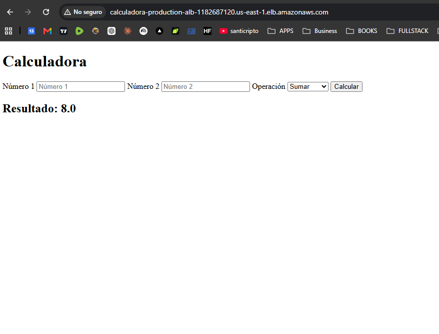

# cicd-pipeline-python-cd

Pipeline de Integración Continua para una calculadora web en Flask, con GitHub Actions, Docker, SonarCloud y publicación en Docker Hub.

## Integrantes

`AUTOR`: Santiago Alvarez | Emmanuel Correa | Tomás Echavarria | José David Toro

| Nombre completo | Usuario de GitHub | Rol |
|---|---|---|
| Santiago Alvarez | SantiagoAlvP | Colaborador |
| Emmanuel Correa | imKorr | Colaborador |
| Tomás Echavarria | tomechava | **Propietario del repositorio** |
| José David Toro | josedtf | Colaborador |

## Evidencias

- **Ejecución del pipeline (merge de las nuevas funciones):** https://github.com/tomechava/cicd-pipeline-python-cd/actions/runs/43905838316
- **Pull Request de las nuevas funciones:** https://github.com/tomechava/cicd-pipeline-python-cd/pull/1

**URLs de los ambientes:**

```plaintext
Staging:    http://calculadora-staging-alb-1843060026.us-east-1.elb.amazonaws.com
Production: http://calculadora-production-alb-1182687120.us-east-1.elb.amazonaws.com
```




