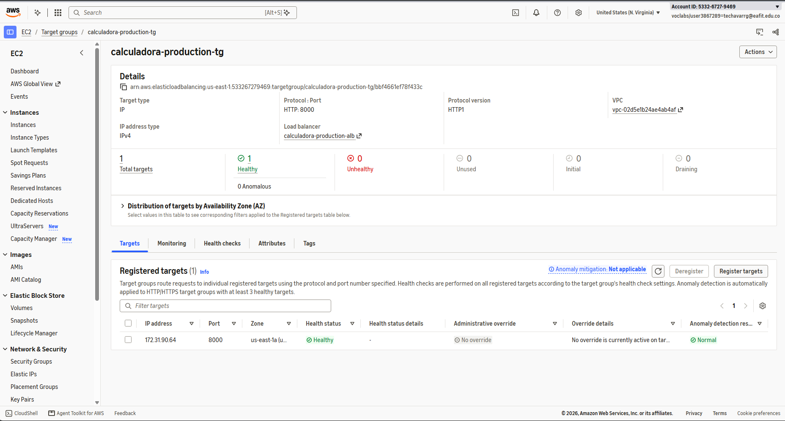

# cicd-pipeline-python-cd

Pipeline de Integración Continua para una calculadora web en Flask, con GitHub Actions, Docker, SonarCloud y publicación en Docker Hub.

## Integrantes

`AUTOR`: Santiago Alvarez | Emmanuel Correa | Tomás Echavarria | José David Toro

| Nombre completo | Usuario de GitHub | Rol |
|---|---|---|
| Santiago Alvarez | SantiagoAlvP | Colaborador |
| Emmanuel Correa | imKorr | Colaborador |
| Tomás Echavarria | tomechava | **Propietario del repositorio** |
| José David Toro | josedtf | Colaborador |

## Evidencias

- **Ejecución del pipeline (merge de las nuevas funciones):** https://github.com/tomechava/cicd-pipeline-python-cd/actions/runs/43905838316
- **Pull Request de las nuevas funciones:** https://github.com/tomechava/cicd-pipeline-python-cd/pull/1

**URLs de los ambientes:**

```plaintext
Staging:    http://calculadora-staging-alb-1843060026.us-east-1.elb.amazonaws.com
Production: http://calculadora-production-alb-1182687120.us-east-1.elb.amazonaws.com
```




## Respuestas

### 1. Flujo completo del pipeline

Todo arranca cuando se hace un push o un merge a `main`. Ahí se ejecuta el workflow `ci-cd.yml`, que tiene 5 jobs uno detrás del otro, y si alguno falla los que siguen ya no corren.

El primero es `build-and-test`, que básicamente es el CI del taller 2. Revisa el formato con Black, pasa Pylint y Flake8 y corre las pruebas unitarias (las funciones de `calculadora.py`) y las de componente (las rutas de Flask, incluyendo `/health`), pidiendo mínimo 80% de cobertura. También valida los archivos de Terraform con `terraform fmt -check` y `terraform validate`. Después construye la imagen de Docker usando el SHA del commit como etiqueta, la levanta en un contenedor y le corre las pruebas de aceptación con Selenium. Al final pasa por SonarCloud y, si todo está bien y estamos en `main`, sube la imagen a Docker Hub con la etiqueta del SHA y con `latest`. Lo importante de este job es que deja como salida `image_uri`, que es la imagen con el SHA, y eso es lo que usan los siguientes jobs.

Luego `deploy-staging` toma esa imagen, se conecta a AWS con los secretos, hace `terraform init` con el estado que está en S3, selecciona el workspace `staging` y hace `terraform apply`. ECS levanta la versión nueva y el job espera hasta que quede estable. Al final saca la URL del ALB de Staging.

`test-staging` usa esa URL. Primero se queda preguntándole a `/health` hasta que responda el SHA del commit, para no probar la versión vieja por error, y después corre las mismas pruebas de Selenium pero contra Staging. Estas pruebas revisan desde el navegador que todas las operaciones funcionen (también potencia y módulo) y que los mensajes de error salgan bien.

Después viene la aprobación. Como el job de producción usa el environment `production` y ese environment tiene revisores, el pipeline se queda esperando hasta que alguien lo aprueba.

`deploy-production` hace lo mismo que el de Staging pero en el workspace `production`, y con exactamente la misma imagen que se probó en Staging. Por último, `smoke-test-production` espera a que `/health` muestre el SHA y corre las pruebas de humo, que solo revisan que la página cargue y que `/health` responda `ok` con la versión correcta.

O sea, lo que pasa de un job a otro es la imagen de Docker identificada con el SHA (se construye una sola vez y se despliega igualita en los dos ambientes) y la URL del ALB de cada ambiente. El SHA además le llega al contenedor como `APP_VERSION`, y por eso podemos saber qué versión está corriendo en cada lado.

### 2. Terraform vs. crear todo a mano en la consola

Lo mejor de Terraform es que toda la infraestructura queda escrita en código y guardada en Git, entonces cualquier cambio se puede revisar en un PR y se sabe quién cambió qué. Además, con los mismos archivos montamos Staging y Producción y lo único que cambia es la variable del ambiente, así que quedan iguales. Si lo hubiéramos hecho a mano desde la consola, seguro algún ambiente habría quedado con algo distinto. Y al final, con un `terraform destroy` se borra todo, lo que en AWS Academy sirve mucho para no gastarse el presupuesto.

Lo malo es que tiene su curva de aprendizaje, sobre todo entender el estado, los workspaces y el bloqueo. A veces los errores no son muy claros (credenciales vencidas, el estado bloqueado, recursos que ya existen) y, si alguien cambia algo a mano en la consola, el código y lo que hay en AWS dejan de coincidir.

El estado se guarda en S3 porque desplegamos desde dos lados: primero desde el computador y después desde el pipeline, que cada vez corre en una máquina nueva que se borra al terminar. Si el estado quedara en el computador, el pipeline no sabría que la infraestructura ya existe y trataría de crearla otra vez. En S3 los dos ven el mismo estado, el lock evita que dos `apply` se crucen al mismo tiempo y el versionado del bucket deja recuperar una versión anterior si algo se daña.

### 3. Ventajas y desventajas de tener Staging

La ventaja principal es que la versión nueva se prueba en una infraestructura real, igual a la de producción, antes de que la vea cualquier usuario. Y sí nos sirvió: la primera vez que corrimos el pipeline completo falló en Staging porque Chrome intentaba abrir el ALB por HTTPS, y lo arreglamos (commit `7819e2b`) sin que eso llegara a producción. Si algo falla en Staging el pipeline se detiene ahí, y además nos queda un lugar para probar a mano antes de aprobar.

Las desventajas son que cuesta más, porque es otra infraestructura completa, y que el pipeline se vuelve más lento: el CI solo tarda como 2 minutos y con todo el despliegue se va a unos 10, sin contar el tiempo esperando la aprobación. También hay que tener claro que Staging no es 100% igual a producción, porque no tiene el mismo tráfico ni los mismos datos.

En resumen, se sacrifica un poco de velocidad a cambio de seguridad. Los cambios se demoran más en llegar a producción, pero llegan ya probados, y como todo es automático la demora es de minutos, no de días.

### 4. Diferencia entre las pruebas de Staging y las de Producción

En `test-staging` corremos las pruebas de aceptación completas con Selenium: se abre un navegador, se llena el formulario y se revisa el resultado de cada operación y de los casos de error. Son más completas, pero más lentas y necesitan navegador.

En `smoke-test-production` solo corren las pruebas de humo, que son dos peticiones HTTP con `urllib`: que la página principal cargue y que `/health` responda `ok` con el SHA esperado. Se demoran unos segundos.

La diferencia es porque la funcionalidad ya se probó a fondo en Staging con la misma imagen, entonces repetir todo en producción no aporta mucho. Ahí lo que importa es confirmar que el despliegue salió bien y que está corriendo la versión correcta. Además, así no le metemos tráfico de pruebas pesado a producción y hay menos cosas que puedan fallar por razones que no tienen que ver con la aplicación.

### 5. Qué le falta al pipeline

Para nosotros faltan dos cosas importantes.

Lo primero sería monitoreo y alertas. Ahora mismo tenemos los logs en CloudWatch y el health check del ALB, pero si la aplicación empieza a fallar una hora después del despliegue nadie se entera, porque las pruebas de humo solo revisan el momento en que se despliega. Se podría hacer con alarmas de CloudWatch (errores 5xx en el ALB, targets `unhealthy`, latencia, uso de CPU y memoria) que manden una notificación por SNS a un correo o a Slack, y un dashboard para ver cómo va cada ambiente.

Lo segundo sería escanear la seguridad de la imagen y de las dependencias. SonarCloud revisa nuestro código, pero no revisa si la imagen base de Docker o librerías como Flask y Gunicorn tienen vulnerabilidades conocidas, que es de donde salen muchos problemas. Se podría agregar un paso con Trivy en `build-and-test` que falle si encuentra vulnerabilidades críticas, y activar Dependabot para que abra PRs actualizando las dependencias. Para Terraform hay herramientas parecidas, como Checkov.

### 6. Experiencia de cada integrante

_Cada uno reemplaza su "(pendiente)" con su experiencia._

**Santiago Alvarez:** A mí me pareció muy chévere ver el flujo completo funcionando de verdad. Después del merge del PR no hubo que hacer nada a mano para que las operaciones nuevas llegaran a Staging, y cuando llegaron a producción ya habían pasado por todas las pruebas y por SonarCloud. Cuando probé potencia y módulo en la URL de producción para tomar la captura, sabía que era la misma imagen que se había probado en Staging, y con `/health` se podía ver que estaba el commit correcto. Lo que no me gustó tanto fue lo de las credenciales de AWS Academy, que se vencen cada 4 horas y toca actualizar los secretos en GitHub antes de desplegar, porque si no el pipeline falla aunque el código esté bien. También que cada ejecución se demora como 10 minutos más la aprobación, y para un cambio pequeño eso se siente lento.

**Emmanuel Correa:** Para mí lo más útil fue el feedback rápido. Al abrir el PR con las operaciones nuevas, el pipeline corrió solo y en un par de minutos supe que las pruebas unitarias, las de componente y SonarCloud estaban bien, sin tener que revisar nada a mano. Con la rama `main` protegida y la aprobación de un compañero, sentí que el cambio estaba mejor cuidado que cuando todos hacíamos push directo. Lo que más me gustó fue ver el pipeline detenerse en Staging cuando Chrome intentaba abrir el ALB por HTTPS: encontramos el problema ahí, lo corregimos y nunca llegó a producción. Lo que no fue tan útil es que algunos errores del pipeline tardan en entenderse, como un `terraform apply` que falla por el estado bloqueado o por credenciales vencidas, y el log no siempre dice claramente cuál es la causa. A veces tocaba abrir varios pasos para encontrar el error real.

**Tomás Echavarria:** Me gustó mucho aprender las buenas practicas que mitiguen los riesgos de mal desarrollo usando fases de testeo, despliegue a diferentes ambientes y chequeos del codigo en diferentes ambitos. Ya conocia bastante del tema pero profundicé y conoci nuevas herramientas uy utiles.

**José David Toro:** Lo que más aprendí fue a ver el despliegue como algo que se puede repetir en vez de algo que se hace una sola vez a mano. Con Terraform y los workspaces, Staging y Producción salían de los mismos archivos, y el hecho de que la imagen se construye una sola vez y se despliega con el SHA como identificador me dio confianza de que lo que probamos era exactamente lo que se publicaba. Me pareció muy útil el endpoint `/health` mostrando el SHA, porque permitía confirmar qué versión estaba corriendo en cada ambiente sin adivinar. Lo que me costó fue el manejo de credenciales y secretos: las credenciales de AWS Academy se vencen y hay que actualizarlas en GitHub antes de cada despliegue, y si se olvida el pipeline falla aunque el código esté bien. También se siente lento esperar casi 10 minutos y una aprobación para un cambio pequeño, aunque entiendo que ese costo es lo que hace el despliegue más seguro.

### 7. ¿Entrega Continua o Despliegue Continuo?

Con la aprobación manual es Entrega Continua. Todo lo que entra a `main` se construye, se prueba y se despliega solo en Staging, así que siempre hay una versión lista para producción, pero el paso a producción no es automático: el environment `production` tiene revisores y el job se queda esperando hasta que alguien lo aprueba. Si fuera Despliegue Continuo, lo que pasa las pruebas de Staging llegaría solo a producción.

Antes de aprobar abrimos la URL de Staging y probamos las operaciones nuevas: potencia con 2 y 3 (daba 8.0), módulo con 10 y 3 (daba 1.0) y módulo por cero, que tenía que mostrar el error. También revisamos que las operaciones de antes siguieran funcionando y que `/health` mostrara el SHA del merge.

Si una versión nueva no pasara el health check, el ALB la marcaría como `unhealthy` y no le mandaría tráfico, y ECS la detendría y trataría de lanzar otra. Mientras tanto la versión anterior sigue atendiendo, porque está configurado para no bajar del 100% de tareas sanas, entonces el servicio no se cae. Después de varios intentos fallidos, el circuit breaker marca el despliegue como fallido y vuelve solo a la última versión que funcionaba. En el pipeline eso se nota porque el `terraform apply` termina con error, o porque el paso que espera el SHA en `/health` se vence, ya que sigue mostrando el SHA viejo. Si pasa en Staging, el pipeline se para ahí y esa versión nunca llega a producción.
